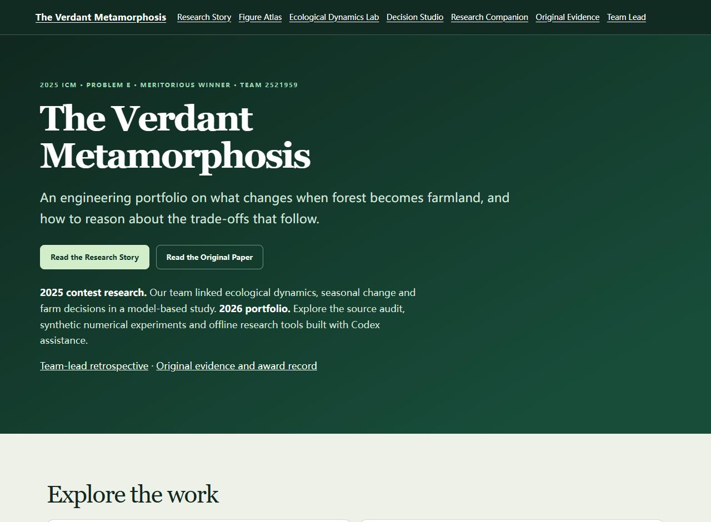

# The Verdant Metamorphosis

### From an award-winning mathematical modeling paper to an interactive sustainability research laboratory

**2025 ICM · Problem E · Meritorious Winner · Team 2521959**

**[English](README.md) | [简体中文](README.zh-CN.md)**

[**Explore the live website**](https://tyf009.github.io/MCM-2025-Problem-E-Meritorious-Winner/site/) · [Original 2025 paper](paper/2521959.pdf) · [Research evidence](docs/FIGURE_ATLAS.md) · [Engineering tests](.github/workflows/portfolio-smoke.yml)

*Original research in 2025. A new, explorable engineering interpretation in 2026.*

---

## The question behind the project

**What happens when a forest becomes farmland—and can mathematical models help us reason about more sustainable choices?**

Converting land for agriculture does not only change the landscape. It changes food webs, seasonal cycles, species interactions and the consequences of human interventions. Farming decisions must also account for production and economic realities.

In the **2025 Interdisciplinary Contest in Modeling (ICM), Problem E**, our team approached this interdisciplinary challenge through an engineering mindset: break a complex system into tractable questions, connect mathematical models to assumptions, examine scenarios, and translate findings into decisions. Our submission earned the **Meritorious Winner** designation.

I led the team with a motivation that still shapes this project: **use quantitative engineering and mathematical modeling to contribute to a meaningful sustainability problem**. I did not set out to present myself as an ecologist. I wanted to understand how modeling can connect ecological complexity to structured, explainable decisions.

The original research is preserved. In **2026**, I expanded it into an interactive portfolio so visitors can explore the reasoning, change inputs, run reproducible *illustrative* experiments, and inspect the evidence and limitations themselves.

**Research record:** [Official Problem E](problem/2025_ICM_Problem_E.pdf) · [Submitted paper](paper/2521959.pdf) · [COMAP results](https://www.contest.comap.com/undergraduate/contests/mcm/contests/2025/results/2025_ICM_Problem_E_Results.pdf) · [Award evidence](figures/certificate.png)

## Experience the research

Start with the [**interactive website**](https://tyf009.github.io/MCM-2025-Problem-E-Meritorious-Winner/site/). Each module answers a different question; together, they form a path from research to engineering experiments to decision support.

| Module | Explore |
| --- | --- |
| **01 · Research Story** | [Read seven research chapters](https://tyf009.github.io/MCM-2025-Problem-E-Meritorious-Winner/site/#research) with the original figures, source-linked decision trails and a [team-lead retrospective](https://tyf009.github.io/MCM-2025-Problem-E-Meritorious-Winner/site/#team-lead). Follow the model assumptions and reported findings back to the submission. |
| **02 · Ecological Dynamics Lab** | [Change model parameters](https://tyf009.github.io/MCM-2025-Problem-E-Meritorious-Winner/site/#lab), rerun a seeded three-population simulation, inspect time series, phase space, signed interactions, local stability and sensitivity. Explore a separate deterministic example retaining the form of **Eq. 10** with *synthetic* inputs. |
| **03 · Agricultural Decision Studio** | [Compare management scenarios](https://tyf009.github.io/MCM-2025-Problem-E-Meritorious-Winner/site/decision/): continuous exposure, early withdrawal and late withdrawal. Examine computed trajectories, AHP / EWM / CRITIC weights, TOPSIS rankings and a finite-candidate Pareto analysis; export a decision brief. |
| **04 · Research Companion** | [Explore the evidence](https://tyf009.github.io/MCM-2025-Problem-E-Meritorious-Winner/site/companion/) through 18 curated, page-cited notes. Turn supported natural-language commands into **reviewed and approved** parameter drafts, then run existing solvers or try three reproducible model challenges. |

### A closer look

| Research Story | Ecological Dynamics Lab |
| :---: | :---: |
|  |  |
| **Decision Studio** | **Research Companion** |
|  |  |

### A suggested five-minute visit

1. **Understand the problem:** follow the forest-to-farm research story and [Figure Atlas](docs/FIGURE_ATLAS.md).
2. **Touch the mathematics:** change a growth, interaction or noise parameter and observe a newly calculated trajectory.
3. **Make a decision:** compare withdrawal timings, then change the decision weights to see how preferences alter a ranking.
4. **Challenge the evidence:** ask what the paper reports—and which parameters or measurements are *not* available for independent reproduction.

## Research → model → decision

The original paper studied an agricultural transition through several connected mathematical perspectives. The interactive portfolio makes that workflow easier to inspect:

| Research stage | Questions and methods |
| --- | --- |
| **System decomposition** | How do forest conversion, food-web relationships, crop cycles and management choices interact? |
| **Ecological modeling** | How can population dynamics, age structure, stochasticity and interactions represent a changing ecosystem? |
| **Intervention analysis** | What does the submitted study report about returning species, chemical withdrawal and beneficial organisms? |
| **Multi-criteria evaluation** | How do ecological and practical objectives enter a weighting and trade-off framework? |
| **Decision communication** | How are modeling results translated into a recommendation for a farmer—and what are the limits of that advice? |

The 2025 paper contains **29 numbered equations**, **15 numbered figures**, and an additional radar chart in the farmer letter. The [paper audit](docs/PAPER_AUDIT.md), [figure atlas](docs/FIGURE_ATLAS.md), and [model traceability record](docs/MODEL_TRACEABILITY.md) connect those artifacts to their original PDF pages.

## What I engineered after the competition

The 2026 work is not a cosmetic replacement for the contest PDF. It is an engineering extension designed around **reproducibility, traceability and interaction**.

| Engineering focus | Implementation |
| --- | --- |
| **Numerical computation** | JavaScript simulation engine; seeded Euler–Maruyama and deterministic Euler; parameter constraints, numerical safeguards and regression/reference tests. |
| **Model inspection** | Time series, phase projection, interaction matrix, local deterministic Jacobian/equilibrium analysis and one-at-a-time sensitivity. |
| **Controlled experiments** | Aligned initial conditions and solver grids for three exposure schedules; computed endpoint differences and population integrals. |
| **Decision algorithms** | AHP pairwise judgments and consistency; entropy weights; CRITIC; explicit hybrid weighting; TOPSIS; finite-set Pareto dominance. |
| **Evidence-aware interaction** | Offline source retrieval with exact PDF-page citations, restricted command parsing, explicit user approval and reusable experiment exports. |
| **Engineering quality** | Node.js tests, 50 curated retrieval/command evaluation cases, Chromium desktop/mobile CI, source-integrity verification and deterministic static builds. |

**AI's role:** Codex assisted with the **2026 development process**. The deployed website itself runs **offline, deterministic retrieval and parsing**, *not* a runtime large language model. Numerical results come from the documented solvers, never from generative text.

### Important: what is original, and what is illustrative?

| Layer | What it means |
| --- | --- |
| **2025 contest research** | The preserved team submission, its mathematical definitions, figures and *reported* findings. |
| **2026 structural exploration** | An implementation of the **form** of a paper equation (such as Eq. 10) using clearly declared, author-chosen synthetic parameters. |
| **2026 independent teaching model** | A separate three-population stochastic example, built to let visitors explore dynamics—not an implementation of the full original AED model. |
| **2026 AI-assisted software work** | A research interface and reproducible software developed with Codex assistance; no claim of contest-era AI use or runtime generative AI. |

**Scientific boundary.** The archived materials do not include all raw observations, fitted parameters, initial histories, economic series or historical optimizer populations. Consequently, the interactive simulations **do not reproduce or independently validate** the paper's reported trajectories, intervention percentages, 15-year forecasts or Milkwood Farm outcomes. The displayed synthetic time, exposure and population indices are **not** calendar years, measured chemical doses, yield or revenue. The audit also records source-equation issues in Eqs. 9, 17 and 27 rather than silently correcting historical work.

## Reproduce it locally

The published portfolio is a static site. No account, backend, paid model API or secret is required to explore it.

**Requirements:** Node.js 22+ and npm. From the repository root:

\`\`\`bash
npm ci --ignore-scripts
npm run build
npm run verify:dist -- --rebuild
npm run preview
\`\`\`

Open the printed local URL. The preview mirrors GitHub Pages' repository subpath and includes the original paper and rendered research documentation.

Run the engineering checks:

\`\`\`bash
npm test
npx --no-install playwright install chromium
npm run test:browser
\`\`\`

For the source-PDF verification, also install the pinned Python dependency:

\`\`\`bash
python -m pip install -r tools/requirements-release.txt
python tools/verify-paper.py
\`\`\`

On Linux CI, Chromium is installed using \`npx --no-install playwright install --with-deps chromium\`. Every numerical experiment can export its solver settings, provenance, seed where applicable, and computed results as JSON or CSV.

**Explore the implementation:** [Simulation engine](site/models/engine.mjs) · [Scenario comparisons](site/decision/scenarios.mjs) · [Decision mathematics](site/decision/methods.mjs) · [Citation retrieval](site/companion/retrieval.mjs) · [CI workflow](.github/workflows/portfolio-smoke.yml) · [Release checklist](docs/RELEASE_CHECKLIST.md)

## Research, team and attribution

This project represents two related but distinct efforts:

- **2025 — Team research:** the ICM submission by **Team 2521959** of **Fujian Normal University**, recognized as a **Meritorious Winner**. The original paper, prompt, award evidence, and archived material remain in this repository.
- **2026 — Portfolio engineering:** an interactive reconstruction and interpretation project led by the team leader, extending the paper into auditable demonstrations, research interfaces and software tests.

The team-lead retrospective explains my motivation and what I would improve today. It does **not** invent the original team's internal assignments, meeting history or unrecorded implementation details.

**Sources and notices:** [Original submission](paper/2521959.pdf) · [Official problem](problem/2025_ICM_Problem_E.pdf) · [Official results](https://www.contest.comap.com/undergraduate/contests/mcm/contests/2025/results/2025_ICM_Problem_E_Results.pdf) · [Reuse and attribution notes](docs/REUSE_RIGHTS.md) · [Rights notice](LICENSE).

The source documents and embedded artwork have separate rights considerations. Public availability is not a blanket license for redistribution.

---

**The award records a result. The models reveal a way of thinking. The interactive laboratory makes that thinking explorable.**

[**Launch the portfolio**](https://tyf009.github.io/MCM-2025-Problem-E-Meritorious-Winner/site/) · [**阅读中文版**](README.zh-CN.md)

