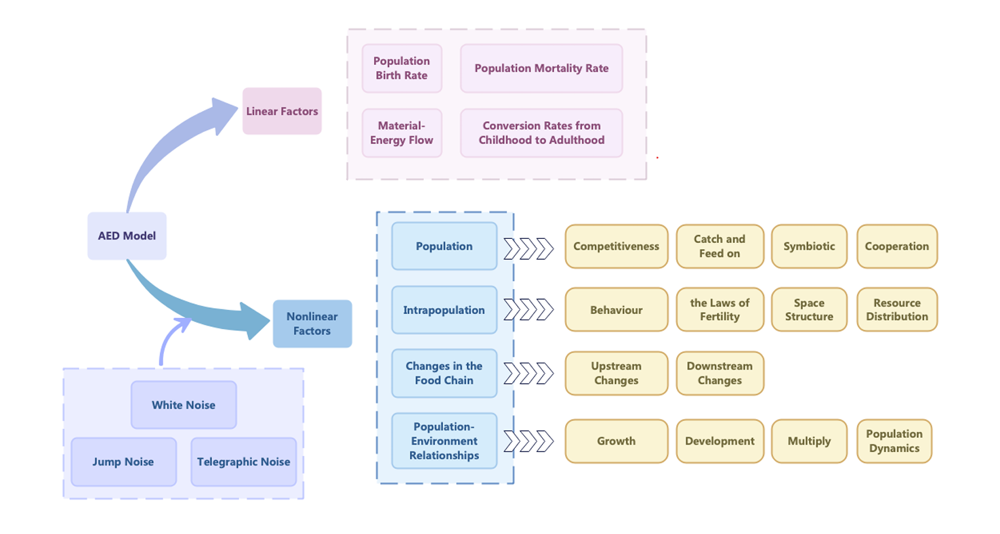
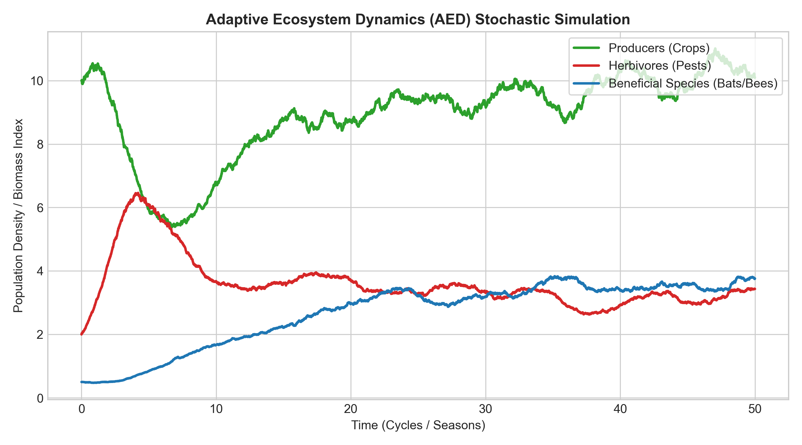
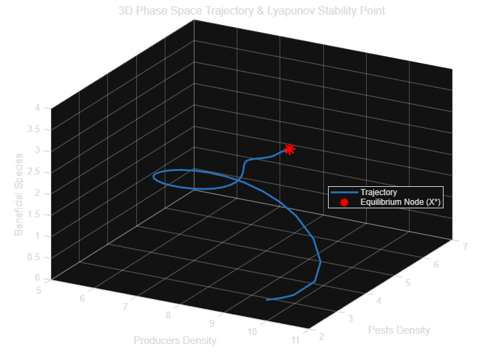
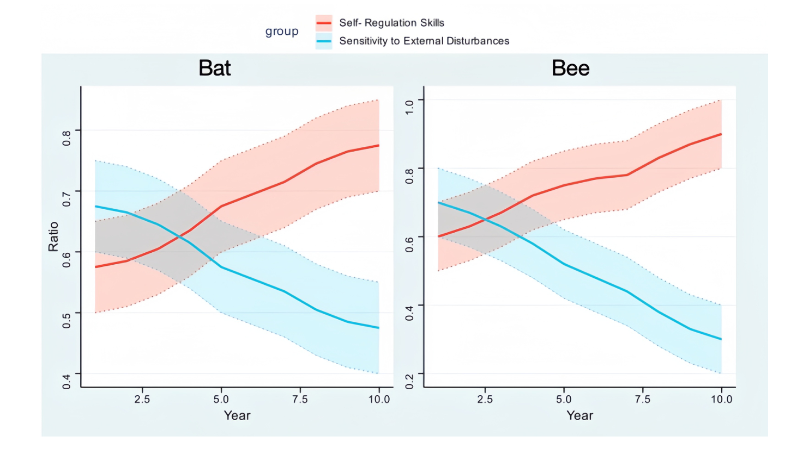
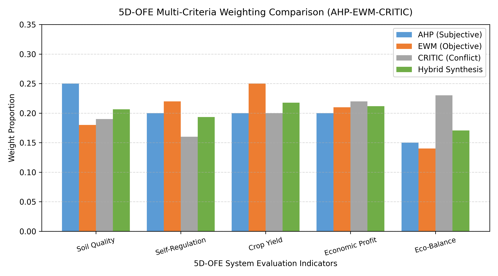
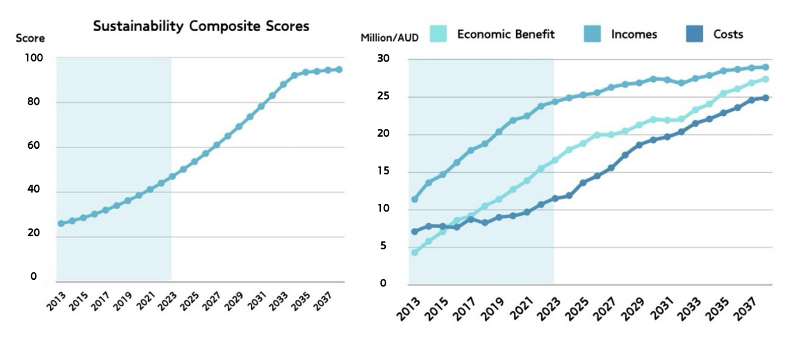
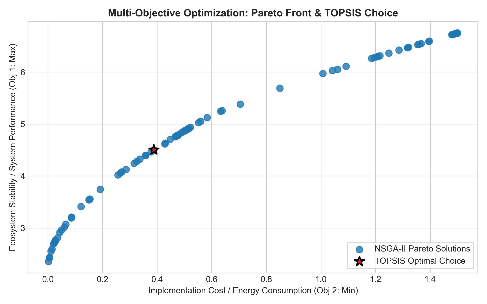
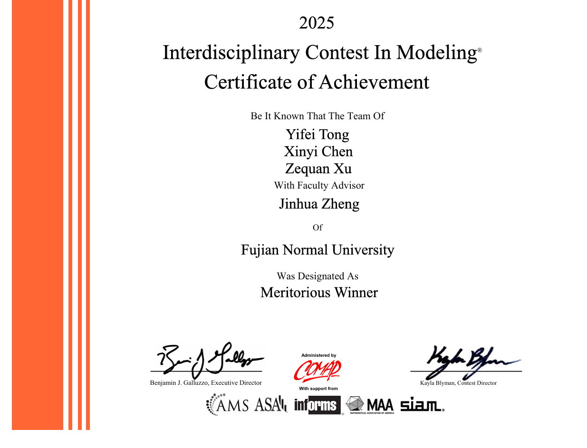

# 🌿 Adaptive Ecosystem Dynamics & Multi-Objective Resource Allocation Framework

> **2025 Interdisciplinary Contest in Modeling (ICM) — Problem E**  
> 🏆 **Award: Meritorious Winner (M-Award)** | Team #2521959  
> *Primary Focus: Complex Dynamical Systems, Stochastic Simulation, Multi-Attribute Decision Making & Sustainability*

[](https://www.python.org/)
[](https://www.mathworks.com/)
[](https://opensource.org/licenses/MIT)

---

## 🌍 Motivation: Bridging Sustainability with Systems Engineering

Our team deliberately chose **Problem E (Sustainability & Ecosystem Transitions)** due to a shared commitment to addressing global ecological vulnerability. However, beyond the agricultural context, the core mathematical models developed in this project serve as a **cross-disciplinary bridge to Communication Engineering & Internet of Things (IoT)**:

* **Stochastic Dynamics $\rightarrow$ Network Topology**: Modeling ecosystem species interactions under environmental noise strongly parallels modeling channel interference, packet loss, and node stability in wireless sensor networks.
* **Multi-Criteria Fusion $\rightarrow$ IoT QoS Optimization**: Synthesizing environmental metrics (5D-OFE) reflects heterogenous data fusion across dynamic IoT edge networks.
* **Resource Allocation $\rightarrow$ Multi-Objective Control**: Balancing ecological preservation against transition costs maps directly to optimizing energy efficiency vs. latency in communication systems.

<div align="center">
  
  <p><i>Figure 1: Macro System Workflow and Evaluation Architecture (from MCM Paper)</i></p>
</div>

---

## 🔍 Problem Analysis, Methodology & Code Implementation

To tackle the complex transition of the Milkwood Farm, we decomposed the problem into four engineering phases, pairing theoretical modeling with numerical code implementation.

### Phase 1: Dynamic Succession Modeling (The AED Framework)
* **Problem**: How to model the highly non-linear, stochastic transition of degraded ecosystems?
* **Methodology**: We proposed the **Adaptive Ecological Dynamics (AED)** framework. We utilized coupled **Stochastic Differential Equations (SDEs)** and integrated environmental noise via dynamic Brownian motion, solving it with the **Euler-Maruyama algorithm**.

$$\mathrm{d}X_i(t) = X_i(t) \left( r_i + \sum_{j=1}^{N} A_{ij} X_j(t) \right) \mathrm{d}t + \sigma_i X_i(t) \mathrm{d}W_i(t)$$

| Theoretical Framework (Paper) | Numerical Simulation (Python Code Output) |
| :---: | :---: |
|  |  |
| *Fig 2: AED Theoretical Framework* | *Fig 3: Code-generated species density trajectory* |

* **Code Module**: `src/python/aed_simulator.py`

---

### Phase 2: Dynamic System Stability & Sensitivity
* **Problem**: Does the proposed transition strategy converge to a stable equilibrium under perturbation?
* **Methodology**: We utilized **MATLAB** to perform **Jacobian Linearization** at steady-state $X^* = -A^{-1}r$ and conducted rigorous **Lyapunov Stability Analysis**. 
* **Proof**: Eigenvalue evaluation yields $\lambda_{1,2} = -0.2145 \pm 0.5068\mathrm{i}$ and $\lambda_3 = -0.1593$. Since $\mathrm{Re}(\lambda_i) < 0$, the system is mathematically proven to be **Asymptotically Stable**.

<div align="center">
  
  <p><i>Fig 4: MATLAB 3D Phase Space Trajectory converging to Lyapunov Equilibrium Node</i></p>
</div>

* **Code Module**: `src/matlab/aed_sensitivity_analysis.m`

---

### Phase 3: Multi-Criteria Data Fusion & Intervention Analysis
* **Problem**: How to objectively quantify the impact of specific interventions (e.g., Beneficial Insects) across environmental, economic, and social domains?
* **Methodology**: We synthesized subjective domain knowledge with objective data entropy using a dynamic **AHP-EWM-CRITIC hybrid weighting algorithm**.

| Intervention Analysis (Paper) | Hybrid Weighting Analysis (Python Code Output) |
| :---: | :---: |
|  |  |
| *Fig 5: Impact of Beneficial Insects* | *Fig 6: 5D-OFE Hybrid Weight Distribution* |

* **Code Module**: `src/python/hybrid_weighting.py`

---

### Phase 4: Multi-Objective Optimization & Long-term Forecasting
* **Problem**: Resolving inherent conflicts between maximizing system resilience and minimizing transition costs over a long period.
* **Methodology**: Formulated a constrained non-linear multi-objective optimization problem. Solved via **NSGA-II** to construct the Pareto Optimal Front, followed by **TOPSIS** to select the ideal trade-off decision node based on relative closeness coefficients.

$$\min_{\mathbf{x}} \mathbf{F}(\mathbf{x}) = \left[ -f_{\text{stability}}(\mathbf{x}), f_{\text{cost}}(\mathbf{x}) \right]^T$$

| Long-Term Forecast (Paper) | Pareto Optimization & Decision (Python Code Output) |
| :---: | :---: |
|  |  |
| *Fig 7: 15-Year System Dynamics Forecast* | *Fig 8: NSGA-II Pareto Front & TOPSIS Decision Node* |

* **Code Module**: `src/python/multi_objective_opt.py`

---

## 🏆 Official Award Certificate

This project achieved the **Meritorious Winner (M-Award)** in the 2025 Interdisciplinary Contest in Modeling (ICM), representing the **Top 6%** among 28,000+ participating international teams.

<div align="center">
  
  <p><i>Figure 9: Official MCM/ICM 2025 Meritorious Winner Certificate (Team #2521959) — <a href="figures/2521959.pdf" target="_blank">Download PDF Certificate</a></i></p>
</div>

---

## 🛠️ Repository Structure

```text
2025-ICM-Problem-E/
├── paper/                     # MCM Contest Paper Submission (PDF)
├── problem/                   # Official Contest Problem E Statement
├── figures/                   # Contest paper illustrations, Code-generated plots & Certificate
├── src/                       # Core Source Code Engine
│   ├── python/
│   │   ├── aed_simulator.py            # SDE Euler-Maruyama Solver
│   │   ├── hybrid_weighting.py         # AHP-EWM-CRITIC Data Fusion
│   │   └── multi_objective_opt.py      # NSGA-II & TOPSIS Engine
│   └── matlab/
│       └── aed_sensitivity_analysis.m  # Jacobian & Lyapunov Stability
└── README.md                  # Project documentation & case study
```
## 🚀 Quick Start & Reproduction

### Prerequisites
* **Python 3.10+** (`numpy`, `matplotlib`, `pandas`)
* **MATLAB R2022b+** (for Lyapunov stability engine)

---

### 1. Run Python Simulation Pipeline

```bash
# Clone repository
git clone [https://github.com/TYF009/2025-ICM-Problem-E.git](https://github.com/TYF009/2025-ICM-Problem-E.git)
cd 2025-ICM-Problem-E

# Run Stochastic SDE Solver
python src/python/aed_simulator.py

# Run Hybrid Data Fusion Weighting
python src/python/hybrid_weighting.py

# Run NSGA-II & TOPSIS Optimization Engine
python src/python/multi_objective_opt.py
```

### 2. Run MATLAB Stability Engine
Open MATLAB, navigate to src/matlab/, and execute:

```Matlab
run('aed_sensitivity_analysis.m')
```
---

## 📜 Citation & Credits
Contest Paper: The Silent Shift, The Verdant Metamorphosis: Adaptive Dynamics & Evaluation Framework (M-Award, Team #2521959).

Author Focus: System architecture design, stochastic dynamic modeling, multi-objective algorithm integration, and Python/MATLAB dual-engine implementation.
