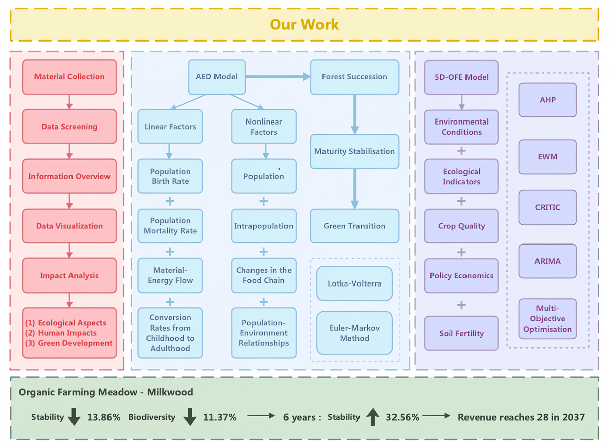

# 🌿 2025 ICM Problem E: Restoring Ecological Balance in Agricultural Ecosystems

-blue?style=for-the-badge)

## 📌 Executive Summary

This repository contains the mathematical modeling solution for **2025 ICM Problem E (Ecological Agriculture)** submitted by **Team #2521959**. Our work was awarded the **Meritorious Winner (M Award)**.

We developed an adaptive ecological-economic modeling framework to simulate ecological succession from natural forest to managed farmland, evaluating human interventions (e.g., removing chemical pesticides, introducing beneficial insects) and projecting long-term sustainability.

---

## 🏗️ Framework & Methodology

Our system combines dynamic biological modeling with multi-dimensional multi-objective decision-making:

*Figure: Overall Modeling Workflow (AED Model & 5D-OFE Evaluation System)*

1. **Adaptive Ecosystem Dynamics (AED) Model**: 
   - Utilizes modified Lotka-Volterra equations and Euler-Markov stochastic simulations to capture non-linear species succession, seasonal agronomic stages, and native species return.
2. **5D Organic Farm Evaluation (5D-OFE) Model**:
   - Built an evaluation framework across 5 dimensions using a hybrid weighting system (**AHP + EWM + CRITIC**).
3. **Optimization & Prediction**:
   - Solved multi-objective trade-offs between yield and ecological balance via **NSGA-II** & **TOPSIS**.
   - Projected 15-year sustainability metrics using **ARIMA(2,1,2)**.

---

## 📊 Key Results & Visualizations

### 1. Beneficial Insect Comparison (Bats vs. Bees)
We evaluated the sensitivity and self-regulation impact of introducing bats (predators/pollinators) versus honeybees under varying agricultural conditions.

### 2. 15-Year Sustainability & Benefit Forecast
Applied to real-world case study (*Milkwood Farm*), our model successfully fits the Pareto front and predicts long-term ecological and economic viability.

---

## 📂 Repository Structure

- `docs/`: Full submission paper (PDF) and official MCM/ICM problem statement.
- `figures/`: Key diagrams, charts, and sensitivity analysis plots used in the paper.
- `src/`: Core algorithm implementations (Ecological differential equations, multi-objective optimization, ARIMA forecasting).

---

## 🏆 Award Certification

- **Contest**: 2025 Interdisciplinary Contest in Modeling (ICM)
- **Problem**: Problem E (Ecology / Sustainability)
- **Designation**: **Meritorious Winner (Top ~6-7%)**
- **Team Control Number**: #2521959

---
*Feel free to star ⭐️ or fork this repository if you find our ecological modeling approach helpful!*
