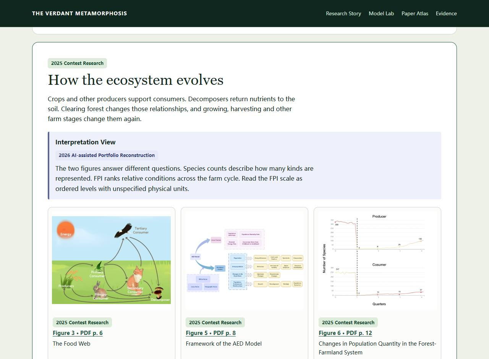
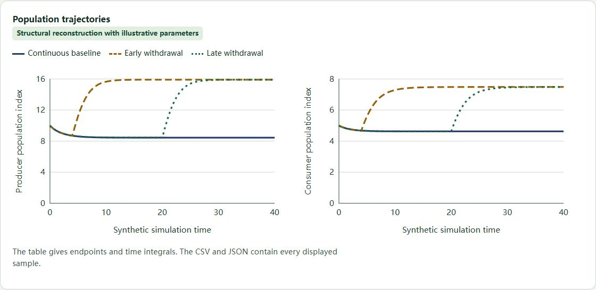

# The Verdant Metamorphosis

**Ecological modeling, reproducible numerical experiments, and transparent decision support for forest-to-farm transitions.**

Team 2521959 from Fujian Normal University earned a **Meritorious Winner** designation for 2025 ICM Problem E. This portfolio pairs the original team research with an independently developed 2026 engineering extension. [COMAP results](https://www.contest.comap.com/undergraduate/contests/mcm/contests/2025/results/2025_ICM_Problem_E_Results.pdf) · [Certificate](figures/certificate.png) · [Archived award PDF](figures/2521959.pdf)

## Research question

When forest becomes farmland, how do changes in species, agricultural cycles, and chemical management interact with the practical need to produce food? The competition paper divides the question into ecological dynamics, seasonal and intervention scenarios, a multi-criteria farm assessment, and a letter for a farmer considering organic practices. [Original submission](paper/2521959.pdf) · [Official Problem E](problem/2025_ICM_Problem_E.pdf) · [Farmer letter, p. 25](paper/2521959.pdf#page=25)

**Team-lead reflection.** I chose this problem to apply quantitative modeling to a meaningful sustainability question. I wanted to connect different models to decisions about ecology, production and cost. In the 2026 portfolio, I prioritized traceable assumptions and experiments another reviewer can rerun. [Research Story and retrospective](site/index.html#team-lead)

## Explore the portfolio

| Area | What to inspect |
| --- | --- |
| [Research Story](site/index.html#research) and [Figure Atlas](docs/FIGURE_ATLAS.md) | Seven chapters, original figures, evidence trails and a page-by-page audit. The complete atlas covers 15 numbered figures and the farmer-letter radar. |
| [Ecological Dynamics Lab](site/index.html#lab) | A reproducible three-population teaching model with seeded Euler–Maruyama, deterministic Euler, signed interactions, phase space, local Jacobian analysis and sensitivity sweeps. A separate Eq. 10 experiment uses the paper’s equation form with synthetic inputs. |
| [Decision Studio](site/decision/index.html) | Continuous, early and late exposure policies on an aligned grid. AHP, entropy weights, CRITIC, TOPSIS and finite-set Pareto calculations expose how preferences affect rankings. Export the scenario record or decision brief. |
| [Research Companion](site/companion/index.html) | Browse 18 curated, cited source notes or query them locally. Review and explicitly approve a restricted scenario command before running an existing solver. Run exposure, noise and preference challenges. |

| Research Story | Ecological Dynamics Lab |
| --- | --- |
|  |  |
| **Decision Studio** | **Research Companion** |
|  |  |

## Reproduce the engineering work

GitHub Pages publication is pending owner review. Build and serve the release candidate locally with Node.js 22 and npm.

```sh
npm ci --ignore-scripts
npm run build
npm run verify:dist -- --rebuild
npm run preview
```

Open the URL printed by the preview server. It mounts `dist/` under the repository-name subpath, including the root landing page, the three site routes and the evidence pages. To reproduce a simulated run, use the preset and seed shown in its output, then download the JSON or CSV record to retain parameters, units, solver version and samples.

```sh
npm test
python -m pip install -r tools/requirements-release.txt
python tools/verify-paper.py
npx --no-install playwright install chromium
npm run test:browser
```

On Linux CI, use `npx --no-install playwright install --with-deps chromium`. The site runtime uses static HTML, CSS and JavaScript modules. The lockfile pins the build and test tools. [Verification workflow](.github/workflows/portfolio-smoke.yml) · [Release checklist](docs/RELEASE_CHECKLIST.md)

## Evidence and limitations

- **Original 2025 contest research.** The submission reports species, exposure, sensitivity and Milkwood forecast results. A completed source audit maps the original figures and 29 numbered equations. It documents the Eq. 9 state-symbol mismatch, Eq. 17 cost expression and Eq. 27 malformed coefficient. [Page audit](docs/PAPER_AUDIT.md) · [Model traceability](docs/MODEL_TRACEABILITY.md) · [Historical scripts](src/) · [Archived figures](figures/)
- **Post-contest numerical exploration.** The models use synthetic coefficients, population indices and simulation time. The archive lacks fitted inputs, initial histories, economic training series, historical optimizer candidates and field measurements. Neither the reported trajectories nor farm outcomes have been independently reproduced or validated here. [Model implementation](docs/MODEL_IMPLEMENTATION_PLAN.md) · [Decision methods](docs/DECISION_STUDIO_SPEC.md)
- **2026 AI-assisted engineering.** Codex assisted development. The companion uses deterministic retrieval and a restricted parser, with no runtime LLM or paid API. The optional server adapter is a design for later security review. [Architecture](docs/AI_RESEARCH_ASSISTANT_SPEC.md) · [Evaluation](docs/AI_EVALUATION.md)

The original paper, prompt, separate award artifacts and historical scripts are preserved in Git. Publication or reuse requires review of the source PDFs and embedded artwork. [Rights notice](LICENSE) · [Attribution and reuse](docs/REUSE_RIGHTS.md)
