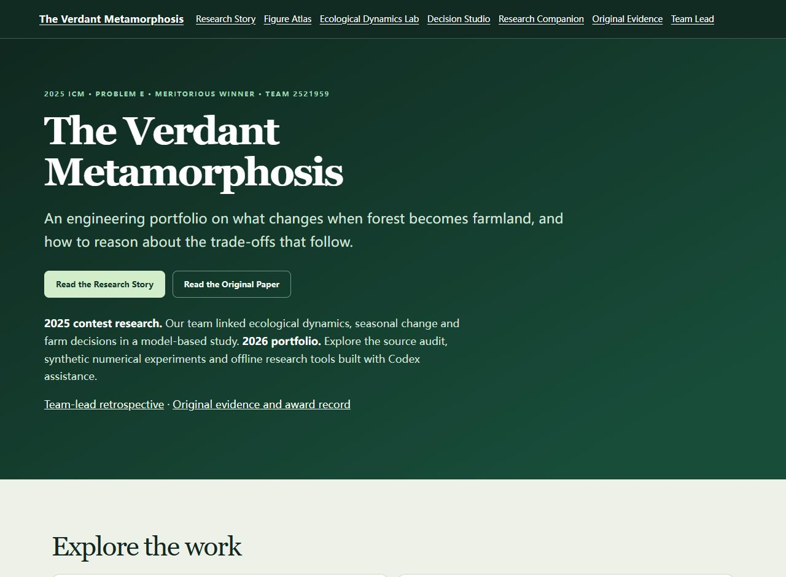
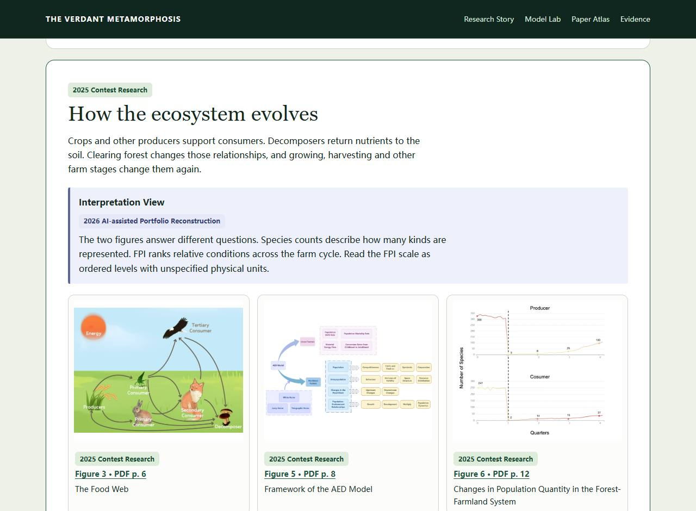
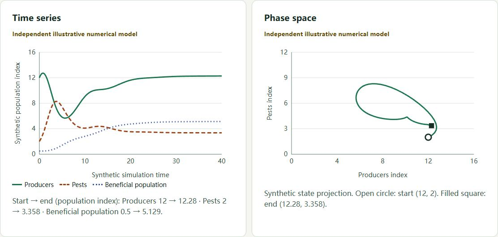
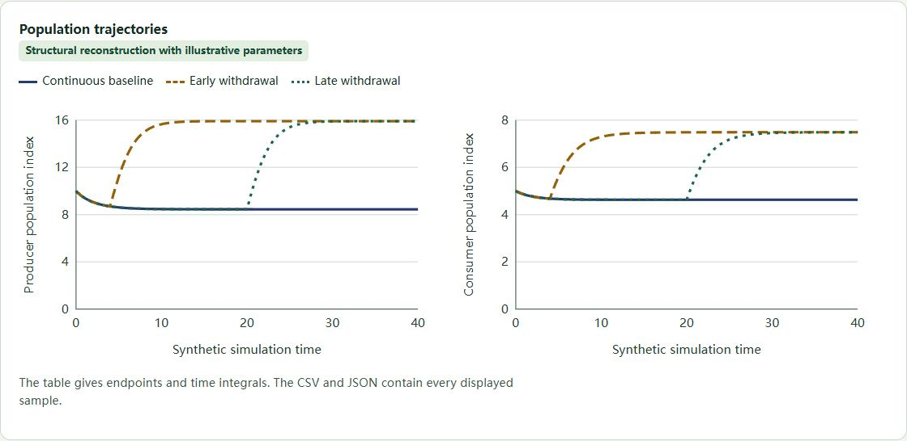
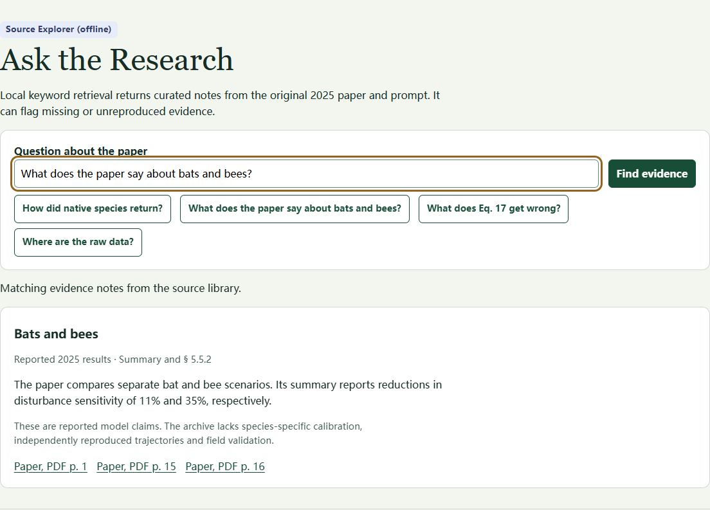

<div align="center">

# The Verdant Metamorphosis
## 绿意蜕变：可交互农业可持续发展数学建模研究实验室

### 从一篇获奖数学建模论文，到可以亲自操作的工程研究作品集

**2025 年美国大学生跨学科数学建模竞赛（ICM）· E 题 · Meritorious Winner · 队伍 2521959**

**[English](README.md) | [简体中文](README.zh-CN.md)**

[**进入在线交互网站**](https://tyf009.github.io/MCM-2025-Problem-E-Meritorious-Winner/site/) · [2025 年原始论文](paper/2521959.pdf) · [论文图谱与证据](docs/FIGURE_ATLAS.md) · [工程测试](.github/workflows/portfolio-smoke.yml)

[](https://github.com/TYF009/MCM-2025-Problem-E-Meritorious-Winner/actions/workflows/portfolio-smoke.yml)

[](https://tyf009.github.io/MCM-2025-Problem-E-Meritorious-Winner/site/)

*2025 年的团队研究成果，2026 年的可交互工程再探索。*

</div>

---

## 一切从一个问题开始

**当森林逐渐转变为农田，生态系统会发生什么变化？数学模型又能如何帮助我们思考更可持续的农业选择？**

土地被转化为农业用途，改变的不只是地貌。食物网、物种间的关系、农业生产周期，以及农药使用等人为干预都会影响生态系统的演变。而现实中的农业决策，还必须考虑生产与经济可行性。

2025 年，我们团队参加了 **ICM E 题**，尝试以工程思维处理这一跨学科问题：先将复杂系统拆解成可以分析的子问题，再建立数学模型、明确假设、比较不同情景，最后尝试把模型研究转化为可解释的决策建议。我们的参赛论文获得了 **Meritorious Winner** 奖项。

作为团队队长，我选择这一题目的初心并不是证明自己是一名生态学专家，而是希望**利用自己的工程知识和数学建模能力，为一个真正有意义的可持续发展问题提供量化分析视角**。我更关注的是：面对复杂、相互关联的现实因素，如何通过系统拆解、模型构建与权衡分析形成有根据的判断。

2026 年，我保留了原始参赛成果，并借助 AI 辅助软件开发，把它延伸为一个**可以阅读、操作、复现和质疑的交互式研究作品集**。访问者不再只能观看论文中的图表，而可以自行改变参数、运行示意实验、比较方案，并追溯每一项结论的来源与限制。

**原始研究资料：** [官方赛题](problem/2025_ICM_Problem_E.pdf) · [参赛论文](paper/2521959.pdf) · [COMAP 官方获奖结果](https://www.contest.comap.com/undergraduate/contests/mcm/contests/2025/results/2025_ICM_Problem_E_Results.pdf) · [获奖证明](figures/certificate.png)

## 从研究走进实验室

建议从 [**在线作品集**](https://tyf009.github.io/MCM-2025-Problem-E-Meritorious-Winner/site/) 开始。四个模块构成一条完整的体验路线：理解研究 → 操作模型 → 比较策略 → 检验证据。

| 模块 | 你可以做什么 |
| --- | --- |
| **01 · Research Story｜研究故事** | [阅读七个研究章节](https://tyf009.github.io/MCM-2025-Problem-E-Meritorious-Winner/site/#research)，查看原始论文插图、带页码的证据链与[队长赛后反思](https://tyf009.github.io/MCM-2025-Problem-E-Meritorious-Winner/site/#team-lead)，理解研究问题是如何被拆解、分析和讨论的。 |
| **02 · Ecological Dynamics Lab｜生态动力学实验室** | [亲自修改参数](https://tyf009.github.io/MCM-2025-Problem-E-Meritorious-Winner/site/#lab)，运行固定随机种子的三种群示意模型；观察时域曲线、相空间、交互系数、局部稳定性和参数敏感性。另有基于论文 **Eq. 10 结构**、采用合成参数的独立确定性实验。 |
| **03 · Agricultural Decision Studio｜农业决策实验室** | [比较不同干预情景](https://tyf009.github.io/MCM-2025-Problem-E-Meritorious-Winner/site/decision/)：持续化学暴露、提前停止和延后停止。查看真实计算产生的模拟曲线，并使用 AHP、EWM、CRITIC、TOPSIS 和有限候选集 Pareto 分析评估不同偏好下的方案排序。 |
| **04 · Research Companion｜研究助手** | [检索 18 条带原文页码的研究证据](https://tyf009.github.io/MCM-2025-Problem-E-Meritorious-Winner/site/companion/)，使用受限自然语言命令生成实验参数草案，逐项验证、批准后才执行数值计算；还可运行三个可复现的模型挑战。 |

### 页面预览

| 研究故事 | 生态动力学实验室 |
| :---: | :---: |
| [](https://tyf009.github.io/MCM-2025-Problem-E-Meritorious-Winner/site/#research) | [](https://tyf009.github.io/MCM-2025-Problem-E-Meritorious-Winner/site/#lab) |
| **农业决策实验室** | **研究助手** |
| [](https://tyf009.github.io/MCM-2025-Problem-E-Meritorious-Winner/site/decision/) | [](https://tyf009.github.io/MCM-2025-Problem-E-Meritorious-Winner/site/companion/) |

### 五分钟体验路线

1. **理解问题：** 从森林到农田的研究故事出发，查看[完整论文图谱](docs/FIGURE_ATLAS.md)。
2. **操作模型：** 调整种群增长率、交互系数或噪声，观察程序重新计算的轨迹。
3. **尝试决策：** 比较不同停止暴露时间，再改变评价权重，观察方案排名是否发生变化。
4. **质疑结果：** 询问论文究竟报告了什么、哪些原始参数或实测数据缺失、目前哪些结果尚不能独立复现。

## 从研究问题到数学模型，再到决策建议

2025 年的论文从多个相互联系的数学角度分析农业生态系统的演变。这次交互式重构，希望让原本分散在论文中的研究流程更容易被理解：

| 研究环节 | 核心问题与思考 |
| --- | --- |
| **系统拆解** | 森林转变、食物网、农业周期与人为管理行为之间存在怎样的联系？ |
| **生态系统建模** | 如何用种群动力学、年龄结构、随机性及物种相互作用描述生态系统变化？ |
| **干预情景分析** | 原论文如何讨论本土物种回归、化学药剂退出、蝙蝠及蜜蜂等有益物种？ |
| **多准则评价** | 如何综合考虑生态目标和农业实际需求，并分析不同权重及目标之间的权衡？ |
| **研究结论沟通** | 如何把模型分析转化为向农场主提供的建议？这些建议有什么证据边界？ |

原始论文包含 **29 个编号公式、15 张编号图**，以及农场主建议信中的一张雷达图。我们通过[逐页论文审计](docs/PAPER_AUDIT.md)、[Figure Atlas](docs/FIGURE_ATLAS.md) 和[模型追溯文档](docs/MODEL_TRACEABILITY.md)，把模型、图表和研究陈述与原始 PDF 页码联系起来。

## 2026 年，我具体做了哪些工程扩展？

这次作品集的升级不是单纯美化 PDF，而是围绕**可复现性、来源可追溯性和真实交互**展开的软件工程工作。

| 工程能力 | 项目中的实现 |
| --- | --- |
| **数值计算** | JavaScript 数值引擎、固定种子的 Euler–Maruyama 随机积分、确定性 Euler 求解、输入边界检查和参考解/回归测试。 |
| **模型分析** | 种群时域曲线、相空间投影、物种交互矩阵、确定性系统局部平衡点与 Jacobian 分析、单参数敏感性实验。 |
| **受控对照实验** | 在相同初始条件与求解网格下比较三种暴露策略，计算终点差异、种群时间积分等示意指标。 |
| **多准则数学方法** | AHP 成对判断与一致性检验、熵权法、CRITIC、明确规则的组合赋权、TOPSIS 排序，以及有限候选集的 Pareto 支配关系。 |
| **证据约束与人机交互** | 离线论文检索、精确 PDF 页码引用、受限命令解析、用户审核/批准后执行、JSON/CSV 实验记录导出。 |
| **软件质量与验证** | Node.js 单元与回归测试、50 条离线检索及命令评测案例、Chromium 桌面/移动端 CI、原始文件完整性校验和可重复构建。 |

**AI 在这里承担什么角色？** 2026 年的开发过程使用了 **Codex 辅助软件工程**。但当前上线的网站**没有在运行大语言模型**：论文检索与命令识别采用确定性离线逻辑，数学结果来自明确实现的数值求解器，而不是生成式文本。

### 请区分原始研究与后续扩展

| 类型 | 含义 |
| --- | --- |
| **2025 原始竞赛研究** | 团队提交的论文、原始数学定义、图表以及论文中**报告**的研究结果。 |
| **2026 方程结构探索** | 采用论文中的某些方程形式（例如 Eq. 10），但使用明确标注的、赛后人为设定的**合成参数**运行实验。 |
| **2026 独立教学示意模型** | 单独实现的三种群随机动力学模型，用于帮助访问者理解参数影响；它不是原始完整 AED 模型的数值复现。 |
| **2026 AI 辅助工程开发** | 在 Codex 辅助下建设研究界面与测试系统；不宣称 2025 年比赛使用过 AI，也不把离线检索伪称为在线大模型智能体。 |

**科学边界十分重要。** 历史归档中缺少完整的原始观测、拟合参数、初始历史状态、经济数据序列和优化算法候选集。因此，当前可操作的模型**并未独立复现或实地验证**论文中的部分生态轨迹、干预百分比、15 年预测及 Milkwood 农场结果。实验中的合成时间、化学暴露指数和种群指数，也不能直接解释为真实年份、药剂剂量、农作物产量或经济收入。逐页审计还记录了论文 Eq. 9、Eq. 17 和 Eq. 27 的表达问题，而没有悄悄改写原始研究记录。

## 本地运行与复现

项目已经通过 GitHub Pages 在线发布，同时保留了可以独立构建和测试的静态工程结构。浏览基本功能**不需要注册账号、后端服务、付费模型 API 或密钥**。

**环境：** Node.js 22 或更高版本、npm。从仓库根目录运行：

```bash
npm ci --ignore-scripts
npm run build
npm run verify:dist -- --rebuild
npm run preview
```

打开终端中显示的本地地址，即可访问与 GitHub Pages 子路径对应的预览版本，包括论文 PDF 与可浏览的研究文档。

运行自动化测试：

```bash
npm test
npx --no-install playwright install chromium
npm run test:browser
```

如需校验论文 PDF 的结构和内容，请安装固定版本的 Python 依赖后执行：

```bash
python -m pip install -r tools/requirements-release.txt
python tools/verify-paper.py
```

Linux CI 使用 `npx --no-install playwright install --with-deps chromium` 安装浏览器。数值实验可以导出 JSON 或 CSV，保存参数、单位、求解器版本、随机种子（如适用）及计算结果。

**主要代码入口：** [数值求解引擎](site/models/engine.mjs) · [干预情景计算](site/decision/scenarios.mjs) · [多准则决策方法](site/decision/methods.mjs) · [证据检索模块](site/companion/retrieval.mjs) · [CI 工作流](.github/workflows/portfolio-smoke.yml) · [发布检查清单](docs/RELEASE_CHECKLIST.md)

## 团队研究、个人思考与致谢

本项目由两个相互关联、但性质不同的部分组成：

- **2025 年｜团队研究：** 福建师范大学 **2521959 队**参加 ICM E 题并获得 **Meritorious Winner**。原始论文、官方题目、获奖材料和历史项目文件均保留在仓库。
- **2026 年｜赛后工程扩展：** 由原团队队长主导，把参赛论文重新组织为能够检验假设、操作示意模型、比较决策结果并追溯证据的交互式研究作品集。

网站中的队长反思记录了我选择这一题目的动机，以及今天会如何改进研究复现、参数记录、实验验证与 AI 辅助交互。它**不虚构当年各成员的具体分工、会议过程或未被保存的历史技术细节**。

**原始资料与使用说明：** [2025 年参赛论文](paper/2521959.pdf) · [ICM 官方题目](problem/2025_ICM_Problem_E.pdf) · [COMAP 获奖结果](https://www.contest.comap.com/undergraduate/contests/mcm/contests/2025/results/2025_ICM_Problem_E_Results.pdf) · [来源与素材使用说明](docs/REUSE_RIGHTS.md) · [权利声明](LICENSE)。

论文、题目及其中部分图像可能受到各自权利限制。公开展示不等于向第三方授予任意复制或再分发许可。

---

<div align="center">

**获奖记录了我们的成果；数学模型呈现了我们的思考方式；交互式实验室则让这种思考变得可以亲自体验。**

[**进入在线作品集**](https://tyf009.github.io/MCM-2025-Problem-E-Meritorious-Winner/site/) · [**Read in English**](README.md)

</div>
